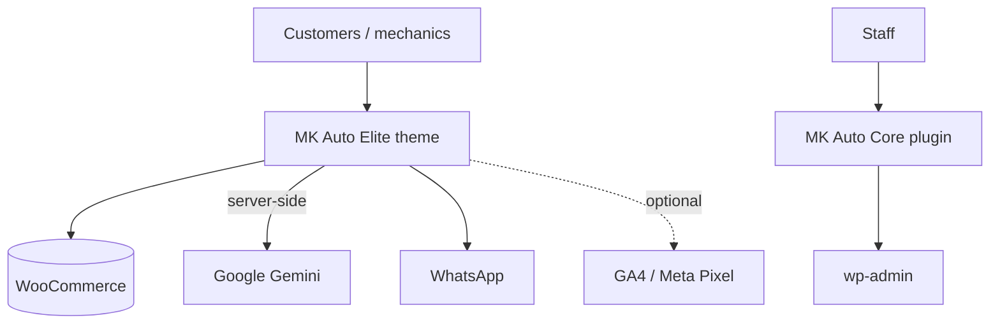
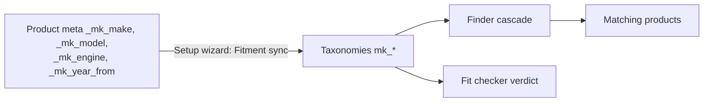
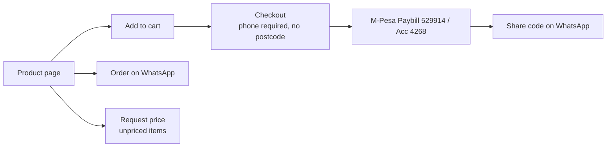
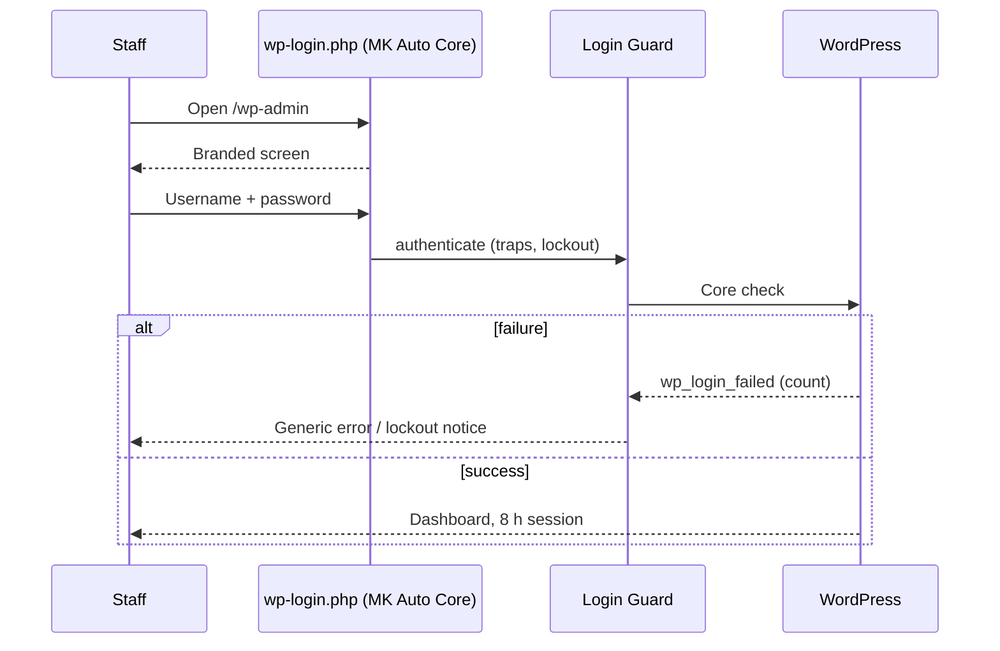

# Architecture

Full technical reference for the MK Auto Spares codebase. For a one-page view see
[ARCHITECTURE-ESSENTIALS.md](ARCHITECTURE-ESSENTIALS.md); for rules see
[AGENTS.md](AGENTS.md).

## 1. Context

mkautospares.co.ke is a WordPress + WooCommerce store for MK Auto Spares,
Kirinyaga Road, Nairobi. Customers are drivers, fleet owners and mechanics,
mostly on phones. The core job is: identify the vehicle, show parts that fit,
let the customer order on WhatsApp or pay by M-Pesa Paybill.



## 2. Packages and boundaries

| Package | Responsibility | Why here |
| --- | --- | --- |
| `mk-auto-elite` (theme) | Everything customers see and the store logic that grew with it: fitment engine, tools, CPTs, AJAX, schema | Original single-package build |
| `mk-auto-core` (plugin) | Staff sign-in screen and login guard | Must keep working if the store is re-themed |

Direction of dependency: the plugin reads the theme's Customizer values
(`get_theme_mod( 'mkae_*' )`) and the theme's hero image and fonts *if present*,
and falls back to its own defaults otherwise. The theme never depends on the
plugin.

**Known debt:** the content model (CPTs, fitment taxonomies), booking, chat and
schema live in the theme. A re-theme would drop them. The planned direction is
to move them into `mk-auto-core` module by module (see [PRD.md](PRD.md) section 6).

## 3. Theme boot

```
functions.php
  ├─ PHP < 8.1 ? admin notice, stop
  ├─ MK_AUTO_ELITE_VERSION / _DIR / _URI
  ├─ inc/autoload.php        (PSR-4 MKAutoElite\ -> inc/src/)
  └─ Theme::instance()
       ├─ Setup, Assets, Customizer
       ├─ Vehicle\Finder, Ajax\Handlers, Woo\WooCommerce, Seo\Schema, Seo\Meta
       ├─ Security, Content, Landing, Analytics
       ├─ Fitment\Tools, Booking\Module, Chat\Module
       └─ is_admin(): Admin\PluginActivation, Admin\Tools, Admin\SetupWizard
```

Each module's constructor only calls `add_action` / `add_filter`, so
instantiation has no side effects. `Theme::module( $key )` returns a module.

## 4. Theme modules

| Module | File | Responsibility |
| --- | --- | --- |
| Setup | `inc/src/Setup.php` | Theme supports, content width, menus (`primary`, `mega`, `utility`, `footer_1-3`), image sizes, Shop Sidebar, `[mkae_directions]`, `[mkae_mpesa]` |
| Assets | `inc/src/Assets.php` | Enqueue CSS/JS (deferred), self-hosted fonts, preloads, resource hints, critical CSS, drops jQuery Migrate and emoji |
| Customizer | `inc/src/Customizer.php` | Panel *MK Auto Elite*; sections Contact & Utility Bar, Brand, Shop, Analytics, Hero, Footer; `Customizer::get()` |
| Vehicle Finder | `inc/src/Vehicle/Finder.php` | Fitment taxonomies, `mkae_vehicle` cookie, `[mk_vehicle_finder]` |
| Fitment Tools | `inc/src/Fitment/Tools.php` | `[mk_parts_finder]`, `[mk_symptom_wizard]`, `[mk_fit_checker]` and product-page checker |
| Ajax Handlers | `inc/src/Ajax/Handlers.php` | All AJAX endpoints (section 6) |
| WooCommerce | `inc/src/Woo/WooCommerce.php` | HPOS declaration, gallery, loop columns, placeholder, price-on-request, trust badges, WhatsApp button, fitment panel, compatibility tab, checkout fields (phone required, no postcode), Paybill notice |
| Content | `inc/src/Content.php` | Knowledge Centre CPT `mkae_guide` (`/knowledge/`) + `mkae_guide_topic`; Locations CPT (`/spare-parts/`) |
| Landing | `inc/src/Landing.php` | CPT `mkae_landing` (`/fitment/`), meta box (make, model, part, symptoms, OEM, price guide, FAQ), draft generator (max 120) |
| Booking | `inc/src/Booking/Module.php` | CPT `mkae_booking`, `[mk_booking_form]`, admin columns and details box |
| Chat | `inc/src/Chat/Module.php` | Floating chat widget, Gemini key setting, WhatsApp hand-off |
| Schema | `inc/src/Seo/Schema.php` | JSON-LD. With Rank Math (live): enriches Rank Math's Organization (AutoPartsStore, address, hours, geo, sameAs) and Product (part brand, MPN, condition, isAccessoryOrSparePartFor, category, shipping, return policy; strips Offer on unpriced items) via `rank_math/json_ld` at 999, then prints only types Rank Math did not (FAQPage, Article). Without Rank Math: full graph |
| Meta | `inc/src/Seo/Meta.php` | Title/description fallbacks for shop, `product_cat`, `mk_make`, `mk_model`, guides, landing and location pages when no Rank Math override; noindex on empty fitment/location archives; default og:image. Uses Rank Math filters, or core filters when Rank Math is absent |
| Analytics | `inc/src/Analytics.php` | GA4 gtag + Meta Pixel in head when IDs set; `window.MKAEA` event config |
| Security | `inc/src/Security.php` | Front-end hardening (see SECURITY-AUDIT.md) and robots.txt |
| Admin | `inc/src/Admin/*` | Plugin nudges, setup wizard page, tools: fitment sync, create pages (About, Contact, Shipping & Delivery, Returns & Refund, Terms, Privacy, Payment Methods, Track Your Order), import 15 Knowledge Centre articles, build menus |

## 5. Plugin: MK Auto Core

| Class | Hooks | Responsibility |
| --- | --- | --- |
| `MKAC_Brand` | - | Reads name, phone, WhatsApp, email, accent from theme mods; logo (Site Logo > bundled `mk-logo.png`); `wa.me` and `tel:` links |
| `MKAC_Login_Brand` | `login_enqueue_scripts`, `login_headerurl`, `login_headertext`, `login_title`, `login_body_class`, `login_header`, `login_message`, `login_footer` | Branded split-screen sign-in |
| `MKAC_Login_Guard` | `authenticate` (20, 30), `wp_login_failed`, `wp_login`, `login_errors` (99), form hooks, `registration_errors`, `lostpassword_post`, password validation hooks, `auth_cookie_expiration`, `login_init`, `admin_init`, `wp_is_application_passwords_available_for_user` | Login hardening |

### Sign-in screen layout

```
body.login.mkac-login (padding-left: 46vw on >= 960px)
├─ aside.mkac-brand          fixed left, charcoal over theme hero.webp, red edge
│   ├─ wordmark + eyebrow
│   ├─ headline, lead, 3 points  (filters: mkac_login_headline, mkac_login_points)
│   └─ phone · domain · ©
├─ #login                    WordPress core markup, restyled
│   ├─ h1 a                  logo via --mkac-logo
│   ├─ .mkac-heading         per action: login / lostpassword / rp / register
│   ├─ form#loginform        unchanged fields, nonces, redirects
│   └─ #nav, #backtoblog
├─ .mkac-help                secure note (HTTPS only), WhatsApp help
└─ .privacy-policy-page-link
```

CSS variables printed inline: `--mkac-accent` (from `mkae_accent`), `--mkac-logo`,
`--mkac-hero`; Inter/Sora `@font-face` from the theme when the files exist.
Below 960px the panel is hidden. The re-authentication pop-up
(`interim-login`) gets no panel, heading or help block.

## 6. AJAX endpoints

All registered for logged-in and logged-out users and verified with
`check_ajax_referer( 'mkae_nonce', 'nonce' )`.

| Action | Purpose | Protection beyond nonce |
| --- | --- | --- |
| `mkae_get_terms` | Cascading fitment options filtered by parent selections | Taxonomy allow-list, transient cache |
| `mkae_search_suggest` | Predictive search (8 results) | Sanitised term, cache |
| `mkae_vehicle_parts` | Parts for the selected vehicle | Allow-listed taxonomies |
| `mkae_check_fit` | Product fit verdict | Sanitised IDs |
| `mkae_submit_booking` | Save booking, email shop and customer | Honeypot `mkae_hp`, minimum fill time, 8 per IP per hour |
| `mkae_chat` | Gemini proxy (`gemini-2.0-flash`, fallback `gemini-1.5-flash`, filter `mkae_chat_model`) | Per-IP throttle per 5 minutes; key never sent to browser |

## 7. Key flows

### Vehicle fitment data



### Order



### Staff sign-in



## 8. Performance

Deferred scripts, minified CSS/JS committed, self-hosted variable WOFF2 fonts,
critical CSS inline, preloads and resource hints, jQuery Migrate and emoji
removed, analytics loaded only when configured, transient caches on fitment and
search lookups. The sign-in stylesheet loads only on `wp-login.php`.

## 9. Release process

1. Change code on `main`.
2. Bump versions (theme: `style.css` + `MK_AUTO_ELITE_VERSION`; plugin: header + `MKAC_VERSION`).
3. Update `readme.txt` changelog, README badges/Security line/Release history, and any affected doc.
4. `grep -rn '\\!'` on changed PHP.
5. Zip and upload the changed folder; clear caches; check versions; smoke test.

## 10. SEO stack

Rank Math (installed on the live site, not in this repo) owns titles, meta, canonicals, sitemaps and the base schema. The theme adds automotive detail and fills gaps; it must never print a second Organization, WebSite, Product or BreadcrumbList. Each entity type appears once per page. Business values used in schema come from *Customize > MK Auto Elite > SEO & Local Business* and *Contact & Utility Bar*.

## 11. Known debt

- Business logic (CPTs, taxonomies, booking, chat, schema) lives in the theme.
- Paybill numbers hard-coded in the checkout notice.
- `readme.txt` in the theme had a stale stable tag (fixed to 2.18.0).
- No automated tests, linting or CI.
