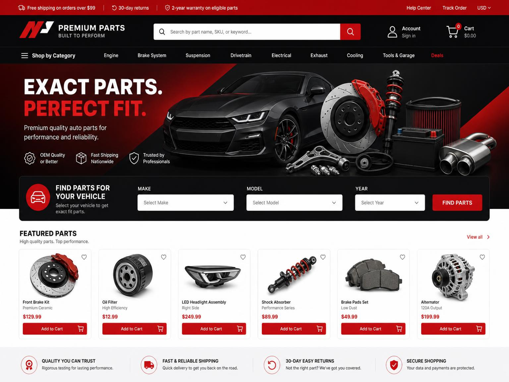
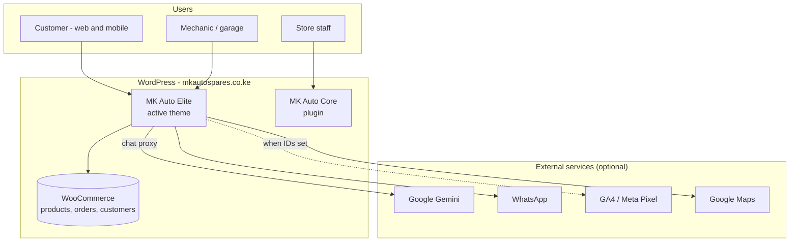
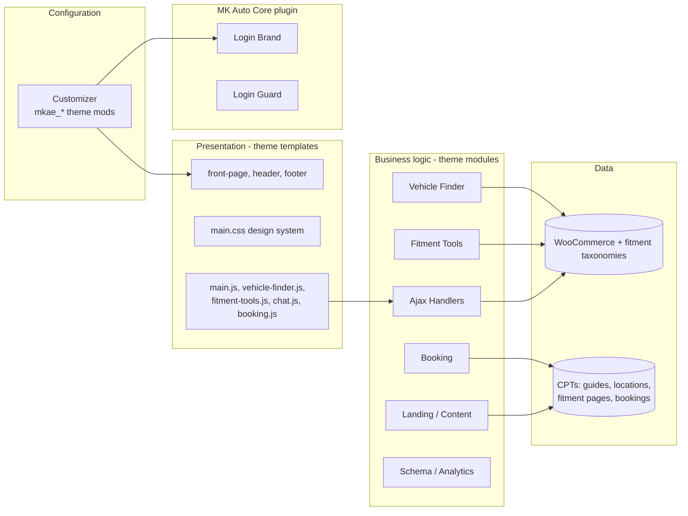
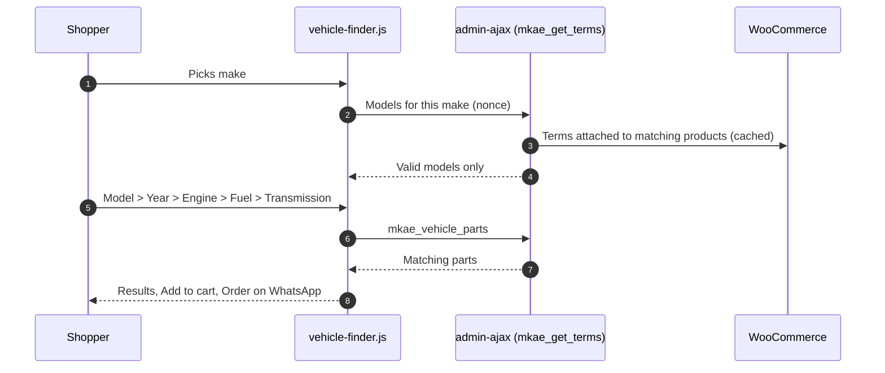
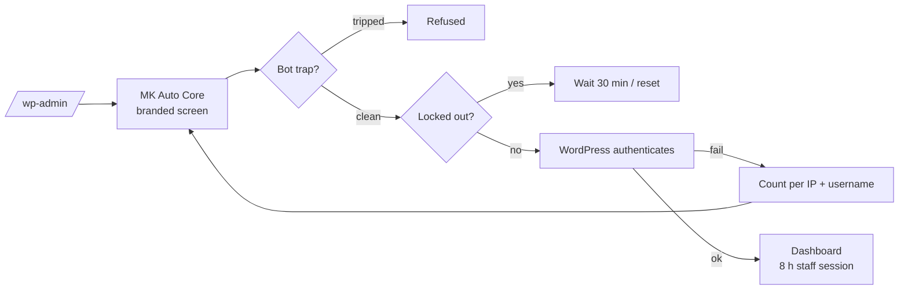
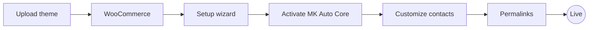

<div align="center">


# MK Auto Spares

**Genuine parts. Trusted fitment.**

Custom WordPress + WooCommerce storefront for **[mkautospares.co.ke](https://mkautospares.co.ke/)** - car, truck and motorcycle spare parts from Kirinyaga Road, Nairobi, built so a customer can find the right part for their vehicle in under 10 seconds and finish the order on WhatsApp or M-Pesa.

<br>

[](mk-auto-elite)
[](mk-auto-core)
[](mk-desk)
[](https://mkautospares.co.ke/)


<br>

**[Visit the store](https://mkautospares.co.ke/)** &nbsp;&bull;&nbsp; [Shop](https://mkautospares.co.ke/shop/) &nbsp;&bull;&nbsp; [Knowledge Centre](https://mkautospares.co.ke/knowledge/) &nbsp;&bull;&nbsp; [Install](#installation) &nbsp;&bull;&nbsp; [Deploy](#deploying-an-update) &nbsp;&bull;&nbsp; [Releases](#release-history)

</div>

<br>

<p align="center">
  
</p>

<br>

## At a glance

<table>
  <tr>
    <td width="25%" align="center"><h3>1 + 1</h3><sub>Packages: theme<br>and core plugin</sub></td>
    <td width="25%" align="center"><h3>6 steps</h3><sub>Make, model, year, engine,<br>fuel, transmission</sub></td>
    <td width="25%" align="center"><h3>M-Pesa</h3><sub>Paybill 529914,<br>Account 4268</sub></td>
    <td width="25%" align="center"><h3>1 tap</h3><sub>WhatsApp order or<br>"Request price"</sub></td>
  </tr>
</table>

## Contents

| | | |
| --- | --- | --- |
| [Packages](#packages) | [Shopping experience](#shopping-experience) | [Staff sign-in](#staff-sign-in) |
| [Architecture](#architecture) | [Project structure](#project-structure) | [Installation](#installation) |
| [Deploying an update](#deploying-an-update) | [Configuration](#configuration) | [Shortcodes and AJAX](#shortcodes-and-ajax) |
| [Release history](#release-history) | [Business](#business) | [Documentation](#documentation) |

## Documentation

| File | Purpose |
| --- | --- |
| [AGENTS.md](AGENTS.md) | Rules and checklist for anyone (human or AI) changing this code |
| [ARCHITECTURE-ESSENTIALS.md](ARCHITECTURE-ESSENTIALS.md) | One-page architecture summary |
| [ARCHITECTURE.md](ARCHITECTURE.md) | Full architecture: modules, data, flows, security layers, release process |
| [PRD.md](PRD.md) | Product requirements and status |
| [SECURITY-AUDIT.md](SECURITY-AUDIT.md) | Security review, fixes and maintenance checklist |
| [docs/SEO-STRATEGY-2026-10.md](docs/SEO-STRATEGY-2026-10.md) | SEO/AEO/GEO audit, competitors, keyword map, roadmap |
| [docs/HANDOVER-2026-10.md](docs/HANDOVER-2026-10.md) | Current state, deploy, rollback, work log |

## Security (theme 2.28.0 / core 1.1.0 / desk 1.6.3)

Production baseline, reviewed 17 Oct 2026 - full detail in [SECURITY-AUDIT.md](SECURITY-AUDIT.md).

| Control | How |
| --- | --- |
| Rate limiting | Login, registration, reset, every public form, theme lookups and the Desk REST route; trusted-IP helper so fake proxy headers cannot bypass it |
| Input sanitisation / output escaping | Every field sanitised by type; every output escaped |
| Passwords | Hashed by WordPress core; 10-character policy; never stored or logged by this code |
| Secrets | From environment or `wp-config.php` (`GEMINI_API_KEY`, `WHATSAPP_TOKEN`, `MKD_DATA_KEY`); none in the repository |
| CORS | No cross-site permission on Desk REST routes |
| SQL injection | Prepared queries throughout |
| Sessions | Staff 8 h (3 days with Remember me) and 60-minute idle logout |
| HTTPS | http to https redirect; HSTS |
| Headers | nosniff, SAMEORIGIN, Referrer-Policy, Permissions-Policy, cross-domain policy, COOP; `no-store` on Desk screens |
| Business rules | One-use payment codes, price/discount permissions, void instead of delete, full activity log |

## Packages

| Package | Folder | Version | Role |
| --- | --- | :---: | --- |
| **MK Auto Elite** | [`mk-auto-elite/`](mk-auto-elite) | `2.29.0` | **Active theme.** Storefront, design system, vehicle-fitment engine, fitment tools, WooCommerce integration, Knowledge Centre, booking, chat, SEO schema, setup wizard |
| **MK Auto Core** | [`mk-auto-core/`](mk-auto-core) | `1.1.0` | Plugin: branded staff sign-in screen, login guard and idle logout. Survives a theme change |
| **MKauto Desk** | [`mk-desk/`](mk-desk) | `1.7.0` | Plugin: back office - till, invoices and receipts, WhatsApp orders, payment plans, sourcing ledger, garage bookings and job billing, reminders, marketing, social, team |

> [!NOTE]
> Nothing brand-specific is hard-coded. Phone, WhatsApp, email, address, hours, M-Pesa instruction, accent colour, map, analytics IDs and the Gemini key are edited under **Appearance > Customize > MK Auto Elite**, and the sign-in screen reads the same values.

## Shopping experience

Designed around how Kenyan drivers and mechanics actually buy parts: on a phone, by vehicle, often confirming fitment and price on WhatsApp before paying with M-Pesa.

<table>
  <tr>
    <td width="33%" valign="top">
      <h4>Find the right part</h4>
      <ul>
        <li>"Find Parts for Your Vehicle" cascade: Make > Model > Year > Engine > Fuel > Transmission</li>
        <li>Predictive search across name, SKU, OEM number and vehicle</li>
        <li>Guided Parts Finder and Symptom > Part wizard</li>
        <li>Mega menu "Shop by Category"</li>
      </ul>
    </td>
    <td width="33%" valign="top">
      <h4>Know it fits</h4>
      <ul>
        <li>"Will this fit your car?" checker on every product</li>
        <li>Compatibility tab and fitment panel on product pages</li>
        <li>Saved vehicle remembered across the visit</li>
        <li>Fitment landing pages (model x part) with symptoms, OEM numbers and FAQ</li>
      </ul>
    </td>
    <td width="33%" valign="top">
      <h4>Order the Kenyan way</h4>
      <ul>
        <li>Lipa na M-Pesa Paybill steps shown at checkout</li>
        <li>Short checkout: phone required, no postcode</li>
        <li>Order on WhatsApp, or "Request price" for unpriced parts</li>
        <li>Service booking form and AI chat with WhatsApp hand-off</li>
      </ul>
    </td>
  </tr>
</table>

<details>
<summary><b>Full feature list</b></summary>

<br>

**Storefront (MK Auto Elite theme)**

- Dark automotive design: charcoal `#111316`, MK red `#CA1D24`; self-hosted Inter and Sora
- Hero with optional motion background, vehicle finder, category tiles, trust strip
- WooCommerce: HPOS compatible, trust badges, WhatsApp button, price-on-request, compatibility tab
- Knowledge Centre (`/knowledge/`) with 15 starter guides (buying guides, common problems, maintenance)
- Location pages (`/spare-parts/...`) and fitment landing pages (`/fitment/...`)
- JSON-LD that works with Rank Math instead of duplicating it: AutoPartsStore with full address and hours, Product with real part brand, OEM number, condition, compatible vehicles, shipping and returns; FAQ; Knowledge Centre Article
- SEO fallbacks (Seo\Meta): keyword-led titles and descriptions for shop, categories, vehicle make/model archives and guides when Rank Math has no override; empty fitment/location archives noindexed; default share image
- GA4 and Meta Pixel with store events (add to cart, WhatsApp click, finder, search, checkout) - off until IDs are entered
- Theme-served `robots.txt` that blocks AI scrapers and faceted URLs
- One-click setup wizard: plugins, fitment sync, pages, articles, menus

| Module | What it does |
| --- | --- |
| **Vehicle Finder** | Fitment taxonomies `mk_make`, `mk_model`, `mk_year`, `mk_engine`, `mk_fuel`, `mk_transmission`; cascading AJAX selects |
| **Fitment Tools** | Parts Finder, Symptom wizard, product fit checker |
| **Landing** | Draft generator for model x part fitment pages (up to 120 per run) |
| **Booking** | `[mk_booking_form]`, saved as Bookings in admin, email to shop and customer |
| **Chat** | Google Gemini assistant proxied server-side; WhatsApp-only when no key is set |
| **Analytics** | GA4 + Meta Pixel injection and event config |
| **Security** | XML-RPC off, enumeration blocked, headers, robots.txt |

**Core plugin (MK Auto Core)**

| Module | What it does |
| --- | --- |
| **Login Brand** | Branded split-screen sign-in at `/wp-admin` |
| **Login Guard** | Lockout, bot traps, rate limits, password policy, staff session expiry, login/admin headers |

</details>

## Staff sign-in

The default WordPress login at [`/wp-admin`](https://mkautospares.co.ke/wp-admin) is replaced by a branded screen from **MK Auto Core**, in the same style as the other Pimofy Digital builds:

- **Left panel (desktop):** dark charcoal over the workshop hero photo, MK red edge, headline *"Genuine spare parts, professionally managed."*, what staff can do once signed in, phone, domain and copyright
- **Right panel:** MK logo, *"Welcome back - Sign in to your MK Auto Spares account"*, the standard WordPress form restyled (rounded fields, red focus ring, full-width black button that turns red on hover), *"Secure, encrypted sign-in"*, *"Need help signing in? Chat with us on WhatsApp"*, lost password, back to site and privacy policy
- **Mobile:** brand panel hidden, centred logo and form
- Headings change for lost-password, reset and register screens; the re-authentication pop-up inside wp-admin stays compact

Only presentation changes: field names, nonces and redirects are untouched, so password managers, 2FA and WooCommerce keep working.

## Architecture

<details>
<summary><b>System context, layers and flows (diagrams)</b></summary>

<br>

#### System context



#### Layered design



#### Flow: vehicle finder



#### Flow: staff sign-in


</details>

## Project structure

<details>
<summary><b>Folder tree</b></summary>

```text
.
├── README.md  AGENTS.md  ARCHITECTURE.md  ARCHITECTURE-ESSENTIALS.md  PRD.md  SECURITY-AUDIT.md
├── docs/images/mk-logo.png
├── mk-auto-elite/                     # Theme (activate this)
│   ├── functions.php                  # Constants + autoloader + boot, nothing else
│   ├── style.css                      # Theme header, version
│   ├── inc/
│   │   ├── autoload.php               # PSR-4: MKAutoElite\ -> inc/src/
│   │   ├── content/                   # Starter page + Knowledge Centre HTML
│   │   └── src/
│   │       ├── Theme.php              # Wires every module
│   │       ├── Setup.php  Assets.php  Customizer.php  Content.php  Landing.php
│   │       ├── Security.php  Analytics.php
│   │       ├── Admin/                 # PluginActivation, SetupWizard, Tools
│   │       ├── Ajax/Handlers.php      # All AJAX endpoints
│   │       ├── Booking/Module.php  Chat/Module.php
│   │       ├── Fitment/Tools.php  Vehicle/Finder.php
│   │       ├── Seo/Schema.php  Woo/WooCommerce.php
│   ├── assets/{css,js,fonts,images}/
│   ├── template-parts/  woocommerce/
│   └── front-page.php header.php footer.php single-*.php archive-*.php ...
└── mk-auto-core/                      # Plugin
    ├── mk-auto-core.php               # Bootstrap
    ├── includes/
    │   ├── class-mkac-brand.php       # Reads mkae_* Customizer values
    │   ├── class-mkac-login-brand.php # Branded sign-in screen
    │   └── class-mkac-login-guard.php # Lockout, traps, policy, sessions, headers
    └── assets/{css/login.css, images/mk-logo.png}
```

</details>

## Installation

> **Requirements:** WordPress 6.4+ &nbsp;&bull;&nbsp; WooCommerce 8.0+ &nbsp;&bull;&nbsp; PHP 8.1+

1. Upload **`mk-auto-elite/`** under *Appearance > Themes > Add New > Upload Theme* and activate it.
2. Install and activate **WooCommerce** when prompted.
3. Run the **MK Auto Elite** setup wizard (admin menu): plugins, fitment sync, pages, Knowledge Centre articles, menus.
4. Upload **`mk-auto-core/`** to `wp-content/plugins/` (or as a zip) and activate it.
5. Set contact details, WhatsApp and M-Pesa under *Appearance > Customize > MK Auto Elite*.
6. Re-save **Settings > Permalinks**.



## Deploying an update

> [!IMPORTANT]
> Commits to `main` do **not** deploy automatically. Every release bumps the version numbers so you can see what is live.

| Step | Action |
| :---: | --- |
| 1 | Download the changed folder(s): `mk-auto-elite/` and/or `mk-auto-core/` |
| 2 | Upload to `wp-content/themes/` and `wp-content/plugins/` on hosting (replace existing) |
| 3 | Clear the caching plugin and any hosting / Cloudflare cache |
| 4 | Check the versions in *Appearance > Themes* and *Plugins* match the badges above |
| 5 | Test on a phone: vehicle finder, search, add to cart, checkout, Order on WhatsApp, and sign in at `/wp-admin` |

## Configuration

| Where | What you can change |
| --- | --- |
| **Customize > MK Auto Elite > Contact & Utility Bar** | Phone, WhatsApp, email, hours, delivery notice, location, address, M-Pesa instruction, map link |
| **Customize > MK Auto Elite > Brand** | Accent colour (also used on the sign-in screen) |
| **Customize > MK Auto Elite > Shop** | "Request price" for unpriced products, Google Maps embed |
| **Customize > MK Auto Elite > Hero / Footer** | Hero motion, video and image; newsletter form action, social links |
| **Customize > MK Auto Elite > Analytics & Tracking** | GA4 ID, Meta Pixel ID, store events on/off |
| **Customize > MK Auto Elite > SEO & Local Business** | Short brand for titles, street, city, county, schema hours, map pin (lat/long), return days, default share image |
| **Customize > MK Auto Elite > AI Chat** | Gemini API key (blank = WhatsApp hand-off only) |
| **Customize > Site Identity > Logo** | Site logo (also used on the sign-in screen) |
| **wp-config.php** | `MKAC_TRUSTED_PROXY_HEADER` when behind Cloudflare |

## Shortcodes and AJAX

| Shortcode | Output |
| --- | --- |
| `[mk_vehicle_finder]` | "Find Parts for Your Vehicle" cascade |
| `[mk_parts_finder]` | Guided Parts Finder |
| `[mk_symptom_wizard]` | Symptom > Part wizard |
| `[mk_fit_checker]` | "Will this fit your car?" checker |
| `[mk_booking_form]` | Service booking form |
| `[mkae_directions]` `[mkae_mpesa]` | Directions button, M-Pesa instruction from the Customizer |

AJAX actions (all nonce-checked with `mkae_nonce`): `mkae_get_terms`, `mkae_search_suggest`, `mkae_vehicle_parts`, `mkae_check_fit`, `mkae_submit_booking`, `mkae_chat`.

## Release history

| Theme | Plugin | Highlights |
| :---: | :---: | --- |
| `2.33.0` | - | SEO/AEO/GEO: live dated price lists (up to 20 in-stock parts) on make, model and category pages; product Quick answers (price, fitment, OEM, delivery); IndexNow pings for Bing/Yandex (auto-off when Rank Math Instant Indexing is active); business sameAs (Google Business Profile, socials, LinkedIn), hasMap and payment methods in schema; llms.txt citation facts and popular searches |
| `2.31.0` | - | SEO: data-driven intros on archives without descriptions, shipping rate + delivery time in product schema, AI crawlers explicitly allowed in robots.txt |
| `2.30.0` | - | SEO/AEO/GEO programme: 10-answer homepage FAQ, data-driven FAQs with live price ranges on category/make/model archives, product title/description fallbacks, facet + search noindex, `/llms.txt`, AI crawlers allowed in robots.txt, richer schema (contactPoint, OfferCatalog, GTIN, PropertyValue, ItemList). See docs/SEO-STRATEGY-2026-10.md |
| `2.28.0` | `1.1.0` | Security: trusted-IP rate limits (fake proxy headers no longer bypass limits), Gemini key from environment and sent in a header, rate limit on public lookups, HTTPS redirect, HSTS and extra headers; core: 60-minute staff idle logout, extra admin headers. Desk 1.6.3: REST rate limit, no CORS for other sites, `no-store` on Desk screens |
| `2.19.0` | - | SEO: schema de-duplicated against Rank Math and enriched (AutoPartsStore, part brand, MPN, condition, compatible vehicles, shipping, 7-day returns); no Offer on price-on-request items; Knowledge Centre Article schema; new Seo\Meta titles/descriptions fallbacks; empty /fitment/ and /locations/ noindexed; Customizer SEO & Local Business section |
| - | `1.0.0` | New MK Auto Core plugin: branded split-screen staff sign-in (logo, Welcome back, WhatsApp help, secure note) and login guard (lockout, bot traps, rate limits, 10-character passwords, 8-hour staff sessions, login/admin headers). Full documentation set added |
| `2.18.0` | - | Current live theme: vehicle finder, fitment tools, fitment landing pages, Knowledge Centre, booking, Gemini chat, GA4/Meta Pixel, security hardening, setup wizard |

## Business

<table>
  <tr>
    <td valign="top">
      <b>MK Auto Spares</b> - Genuine parts. Trusted fitment.<br>
      Along Kirinyaga Road, Nairobi (Glogon, behind Shell petrol station, near Kanju washrooms)<br><br>
      Phone / WhatsApp: <a href="tel:+254702343302">+254 702 343 302</a><br>
      Email: <a href="mailto:info@mkautospares.co.ke">info@mkautospares.co.ke</a><br>
      Mon - Sat, 8:00am - 6:00pm
    </td>
    <td valign="top">
      <b>Payment</b><br>
      Lipa na M-Pesa: Paybill 529914, Account 4268<br><br>
      <b>Delivery</b><br>
      Fast countrywide delivery across Kenya
    </td>
  </tr>
</table>

---

<div align="center">
<sub>Designed, developed and maintained by <a href="https://github.com/moselanto"><b>Pimofy Digital</b></a>, Nairobi &nbsp;&bull;&nbsp; Licensed GPLv2 or later</sub>
</div>

## MKauto Desk (plugin `mk-desk/`, 1.7.0)

The shop's back office under wp-admin > MKauto Desk: Overview, Point of sale, WhatsApp orders, Payment plans, Sourcing, Garage & service, Reminders, Marketing, Social, Settings and Team.

- **Neighbour sourcing:** at the till use *+ Sourced part* (next to search) or the *Sourced* tag on any product tile; sourced catalogue parts do not reduce our stock. Enter the supplier shop, our cost and whether they are paid; the sale goes through and the line lands in *Sourcing* with profit, margin and an owed-to-suppliers ledger (settle a supplier in one click, WhatsApp them the amount).
- **Garage & service:** public page `/garage-service/` (shortcode `[mkd_garage]`, added to the primary menu) books straight into the Desk and hands the customer to WhatsApp; bookings by service type with vehicle, registration number, mileage and mechanic.
- **WhatsApp orders:** whole-cart orders from the cart page plus the theme's single-part leads (vehicle and chassis number) in one list.
- Install: zip the `mk-desk` folder, upload under Plugins > Add New > Upload, activate (WooCommerce required).
